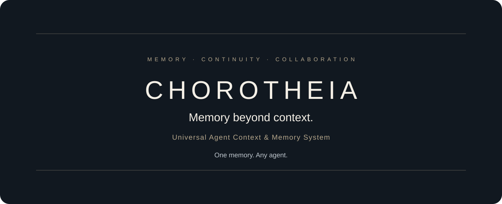

<p align="center"></p>

<p align="center"><strong>让记忆超越上下文的边界。</strong><br>Local-first · Agent-agnostic · One memory. Any agent.</p>

# Chorotheia v1.0.0

**Universal Agent Context & Memory System** — 通用 Agent 上下文与持久化记忆系统。为 Codex、Google Antigravity 与 GitHub Copilot 提供可携带的项目记忆、阶段检查点、上下文恢复和跨 Agent 交接笔记。

Python 3.9+ 标准库运行，使用 Markdown、JSON 和只读 Git。不默认引入数据库、守护进程或云端记忆服务。

[正式版本](https://github.com/ganbaba/chorotheia/releases/tag/v1.0.0) · [版本说明](RELEASE-NOTES.md) · [安装与操作](docs/OPERATIONS.md) · [架构](docs/ARCHITECTURE.md) · [测试](docs/TESTING.md) · [品牌](brand/BRAND.md) · [Skill](skills/chorotheia/SKILL.md)

## 安装

```sh
git clone https://github.com/ganbaba/Chorotheia.git
cd Chorotheia
python3 -B -m unittest discover -s tests -v
python3 -B install.py --dry-run
python3 -B install.py
~/.chorotheia/bin/chorotheia --version
~/.chorotheia/bin/chorotheia doctor
```

也可以下载 Release 中的源码 ZIP 或 tar.gz，核对 SHA-256 后解压安装。默认目标是 `~/.chorotheia/`，安装器备份相关既有配置，仅新增自有文件。有冲突会保留原文件并报告，不合并或覆盖未知设置；`--no-register` 可只安装 CLI。不会修改 shell 启动文件、登录账户或批准原生 Hook 信任。

## 使用

```sh
export PATH="$HOME/.chorotheia/bin:$PATH"  # 仅当前终端
chorotheia init --project /absolute/project --dry-run
chorotheia init --project /absolute/project
chorotheia restore --project /absolute/project --text --budget 2400
chorotheia checkpoint --project /absolute/project \
  --summary '已观察的工作状态' --next '下一步' --test '实际命令及结果，或未执行原因'
chorotheia handoff --project /absolute/project --to antigravity \
  --summary '交接状态' --next '接手后的第一步'
chorotheia recall '检索词' --project /absolute/project
chorotheia audit --project /absolute/project
```

支持 `init`、`retrofit`、`checkpoint`、`restore`、`handoff`、`recall`、`compact`、`status`、`audit`、`repair`、`doctor`、`upgrade`、`uninstall`。初始化支持 auto/new/retrofit/repair/audit 模式和 dry-run。

新旧项目自动识别；现有 README、AGENTS、HANDOFF、业务代码及依赖保持原样。已有路径冲突时创建独立补充空间。私有备份、事务和完整性凭据放在全局 0700 目录，不混入项目共享笔记。

证据按“已确认／推断／未知”记录来源、SHA-256 与 Git 状态。初始读取 L0/L1，按需检索其他记忆；建议初始目标 1500–3000 tokens，默认正文采用保守 2400 UTF-8 字节上限，不声称精确分词计数。

## Agent 接入与 Handoff

| Agent | 配置能力 | v1.0.0 验证边界 |
|---|---|---|
| Codex | SessionStart、PreCompact、PostCompact、Stop | 原生发现/解析已验证；信任审阅及真实会话自动触发仍需目标环境验收 |
| Antigravity | SessionStart、Stop、全局规则与 Skill | 压缩专用事件未确认，使用阶段检查点降级；真实 App 触发待验收 |
| Copilot | 共享 Copilot harness 的会话与压缩前配置 | 不承诺旧 Local harness 或远程环境可用；真实会话触发待验收 |

Git 项目可在可信启动 Hook 中自动初始化；非 Git 目录需显式 init。Hook 保存已记录状态，不能提取尚未写下的工作或隐藏思考。

与 [Universal Handoff](https://github.com/ganbaba/skills/tree/main/agent-handoff) 互补：原控制器继续管理任务、独立工作区、授权及运行凭据。Chorotheia 提供补充记忆和协议 v1 导出，不启动另一 Agent、不伪造运行 token、不改写原控制面。可通过 `install.py --handoff-skill /absolute/universal-handoff/SKILL.md` 记录原 Skill 入口。协议兼容已验证，真实跨服务自动接力尚未联调。

## 安全与验证

实现独占创建、原子发布/替换、fsync、合作进程文件锁、SHA-256 比较、初始化前后完整性核验、描述符相对路径防护、私有所有权凭据和事务回滚。不自动 commit/push/reset/clean/stash，不恢复业务源码。卸载仅移除仍与自有记录吻合的文件，保留修改、私有记忆与备份。

外部编辑器不受合作锁约束，最终校验与替换/删除之间仍有极小竞态；敏感过滤是启发式。恢复不包含原生会话、未保存文件或隐藏思考；compact 是保留原件的逻辑归档。未知旧 UACS/Letheia 格式拒绝猜测迁移；缺少本机所有权凭据的导入记忆暂为只读。详见 [操作说明](docs/OPERATIONS.md) 和 [测试范围](docs/TESTING.md)。

v1.0.0 的品牌与模块命名沿用最终定义。商标查重尚未完成；不使用注册商标标记。本仓库未另行授予开源许可证，公开源码和发布版本不自动构成许可声明；本次未发布到 PyPI 或 npm。
