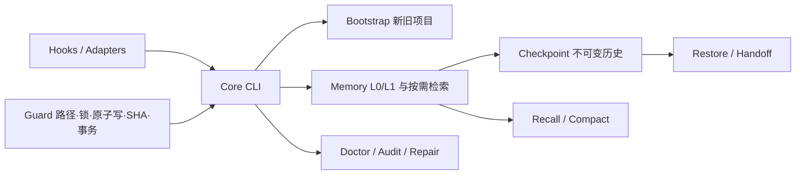

# Universal Agent Context & Memory System

Chorotheia 采用 Local-first、Agent-agnostic 设计。Markdown 为人和 Agent 可读记忆，JSON 为可验证元数据，Git 为只读来源证据；没有数据库或常驻服务。



| 正式模块 | 职责 | 实现 |
|---|---|---|
| Chorotheia Core | 命令与生命周期 | `chorotheia/core.py`、`__main__.py` |
| Chorotheia Bootstrap | 新旧项目识别、冲突隔离、完整性前后核验 | `bootstrap.py` |
| Chorotheia Memory | 分层记忆、来源与敏感模式过滤 | `memory.py` |
| Chorotheia Checkpoint | 当前状态与不可变历史 | `core.py` |
| Chorotheia Restore | L0/L1 恢复及按需读取 | `memory.py`、`core.py` |
| Chorotheia Handoff | 可携带笔记及原协议导出 | `core.py` |
| Chorotheia Guard | 路径、链接、锁、原子写、哈希与回滚 | `guard.py` |
| Chorotheia Compact | 保留原件的逻辑归档 | `core.py` |
| Chorotheia Recall | 字面检索、来源与行号 | `core.py` |
| Chorotheia Hooks | 能力明确的生命周期处理 | `adapters.py` |
| Chorotheia Adapters | 三种 Agent 与原 Handoff 兼容 | `adapters.py`、`installation.py` |
| Chorotheia Doctor | 本机版本、配置及完整性诊断 | `doctor.py`、`core.py` |

## 全局布局

```text
~/.chorotheia/
├── config.toml
├── VERSION
├── bin/
├── core/
├── skills/
├── hooks/
├── adapters/{codex,antigravity,copilot,handoff}/
├── templates/
├── backups/
├── logs/
├── tests/
└── projects/             私有基线与所有权凭据
```

## 项目布局

```text
Project/
├── AGENTS.md             仅不存在时创建
├── README.md             既有文档保留
├── HANDOFF.md            既有文件保留，冲突另建补充
└── .agent/
    ├── manifest.json
    ├── CONTEXT.md
    ├── STATE.md
    ├── DECISIONS.md
    ├── ERRORS.md
    ├── CHECKPOINT.json
    ├── history/
    ├── archive/
    ├── local/
    └── adapters/
```

外部 `.agent/` 被占用时使用 `.agent/chorotheia/`；路径是文件或符号链接时使用 `.chorotheia-agent/`。不覆盖业务内容。

私有全局凭据和所有权记录控制可写范围。项目笔记和历史都是不可信证据，不产生新权限；跨机器导入缺少本机凭据时只读。锁保护合作写者，外部编辑器的极小竞态边界仍存在。
